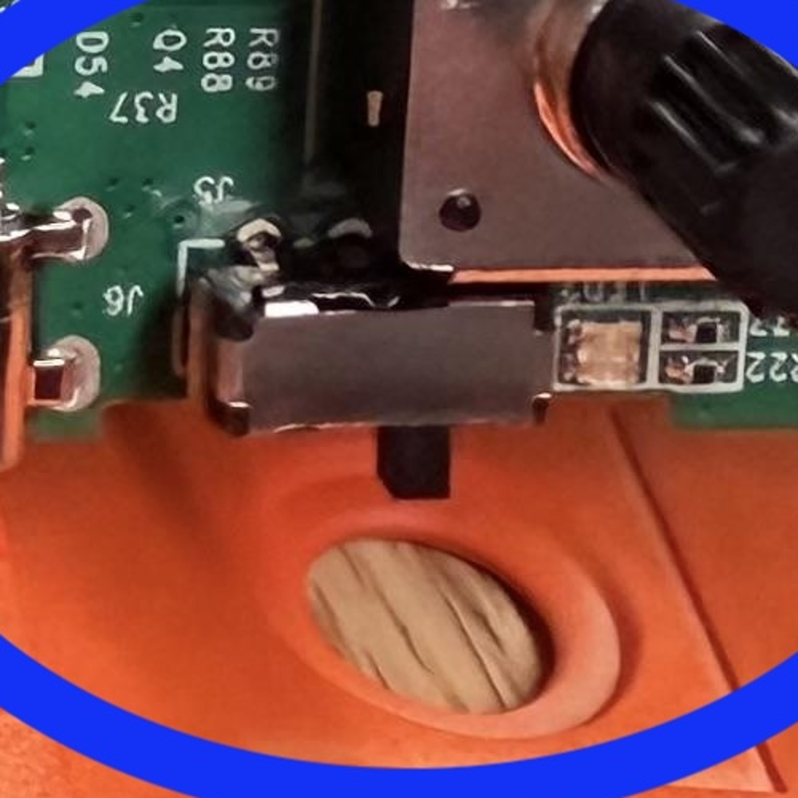
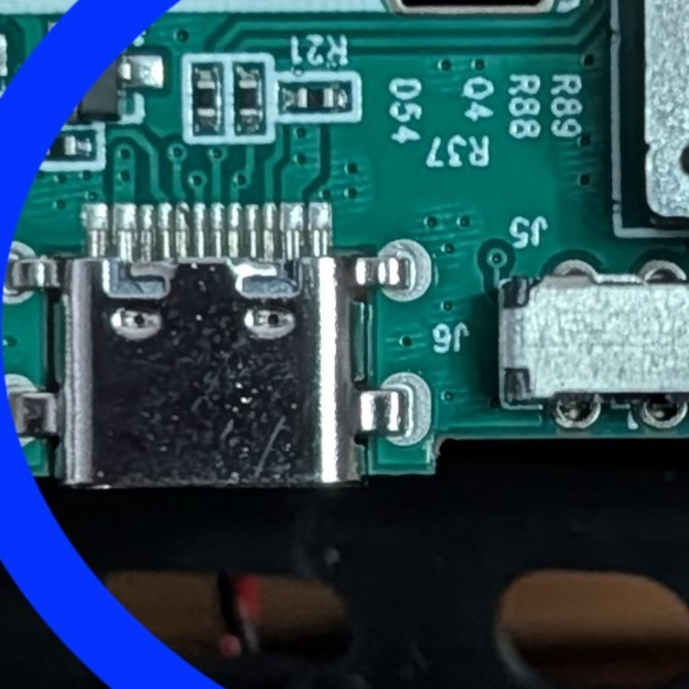

# FM-1 hardware failure: interrupted flash and torn power switch

This is a record of a real failure on a five-day-old M-VAVE FM-1 running Loom
v1.8.4.3, and a warning for anyone flashing an FM-1.

## What happened

1. The FM-1 was updating to Loom v1.8.4.3 over USB.
2. The laptop was moved while the write was in progress; the USB cable was
   jostled/disconnected at about 13 %.
3. The installer stopped with `the loader was disconnected`.
4. After that the FM-1 had a black screen and the charge LED still came on, but
   **no computer saw any USB device** — no `Felucca`, no `WL80UBOOT`, no
   `4C4A:8057` mass-storage device.
5. Power-cycling, a different data cable/port, a phone with the web installer,
   and a full battery charge did not bring USB back.
6. Opening the case to attempt recovery tore the small SMD power switch off the
   board. The switch was not recovered; the external slider is now "mushy"
   because it has nothing to engage.

The unit is effectively e-waste: the firmware needs the Transporter recovery,
and the power switch needs a replacement before the board can even be powered
reliably.

## Photos

The intact switch (reference board, orange case), next to the USB-C port:

The same area on the failed board (black case): the switch is missing, leaving
the two large mounting pads and the small contact pads:

The switch is a small SMD slide switch. The external plastic slider fits over
its actuator; when the board is lifted out of the case while the slider is
engaged, the switch can be pulled off the PCB.

## Why the normal recovery did not work

The update loader is designed to stay in update mode so an interrupted install
can be finished by running the installer again. That requires the loader to stay
alive and re-enumerate over USB.

In this failure the unit no longer enumerated at all, so the software installer
had nothing to talk to. The chip's ROM boot mode (`WL80UBOOT` / `4C4A:8057`)
also did not appear on its own. Recovery then requires forcing the ROM boot mode
with the [FM-1 Transporter](https://github.com/kurogedelic/FM-1-transporter):

- an RP2040/RP2350 board wired to the FM-1's USB **D+, D− and GND** (no VBUS),
- `wl82loader.bin` from `jl-uboot-tool`,
- a full flash backup before writing,
- the official M-VAVE firmware to restore the unit, then Loom over USB.

The Transporter also needs the FM-1 to power on, which is why the missing switch
blocks that path.

## Design issues this exposed

- **No hardware recovery button.** An interrupted write can leave the unit
  black and non-enumerating; software cannot recover a device that is not on
  USB.
- **The update is sensitive to cable movement.** A normal reboot is safe; losing
  the cable *during the write* is the dangerous case.
- **The case is not designed for disassembly.** The external slider engages a
  small SMD switch; lifting the board can tear the switch off. The switch is a
  commodity part, but the device is low-cost and a bench repair costs more than
  a replacement.
- **No economical alternative device** with a hardware recovery button was
  available to the owner. The FM-1 is one of the few hackable devices in this
  class, which makes the missing recovery path more significant, not less.

## Safety improvements since this failure

The update loader has been hardened so a cable pull or a stalled host no longer
leaves the unit in an ambiguous state:

- **Red/green screen.** The loader now drives the panel: solid red while the
  update is in flight (do not disconnect), solid green only after every sector
  is written, verified and the update record cleared (safe). The running
  firmware shows the same red screen before it hands off to the loader, so the
  whole update is visibly "unsafe" until it is done.
- **Flashing red "RECONNECT".** If the host disappears mid-write, the loader
  stops writing, flashes the red screen, and waits for the host to resume (the
  update record is kept, so a re-run finishes the install). After 30 seconds
  with no host it drops into the mask-ROM UBOOT recovery path on its own.
- **App-only writes, head untouched.** The loader still writes only the app
  area and never the flash head (SPL / `isd_config`), and it verifies the whole
  package before erasing anything. A damaged, truncated or foreign-key package
  is refused with nothing erased.
- **Frozen loader.** `LDR_ABI` marks the loader's interface contract. The loader
  code is the same frozen bytes in every release (it is staged fresh on each
  update, because it is erased after a successful boot), and it still writes
  only the app area, never the flash head. Only the first install (stock →
  Loom) first brings the Loom loader onto the device; later updates change only
  the app.

## Warnings for other users

- **Do not move the laptop, the FM-1, or the USB cable during a flash.** Put the
  laptop on a stable surface; use a cable that will not be kicked; do not close
  the lid or let the machine sleep.
- **Back up projects and presets before flashing.** The update writes the
  application area; a failed write can leave the unit unusable until recovered.
- **Do not open the case unless you are prepared to repair the power switch.**
  The external slider can tear the SMD switch off the board. If you must open
  it, move the slider to a position where it is least engaged, lift the board
  evenly, and check that the switch stays on the PCB.
- **If the unit is black and no USB device appears,** check for `WL80UBOOT` /
  `4C4A:8057` first. If it is absent, the normal installer cannot help; the
  Transporter is the documented recovery.
- **A normal reboot is not the risk.** The risk is an interrupted write.
- **Watch the screen.** Newer loaders show red while writing, green when done,
  and a flashing red "RECONNECT" if the cable comes loose. Green is the only
  "safe to unplug" signal.

## Status

The failed unit is not being replaced. A replacement has the same
no-recovery-button design, and at this price point another unit is not a
justified risk for the owner. This note exists so other users can make an
informed decision before flashing.
